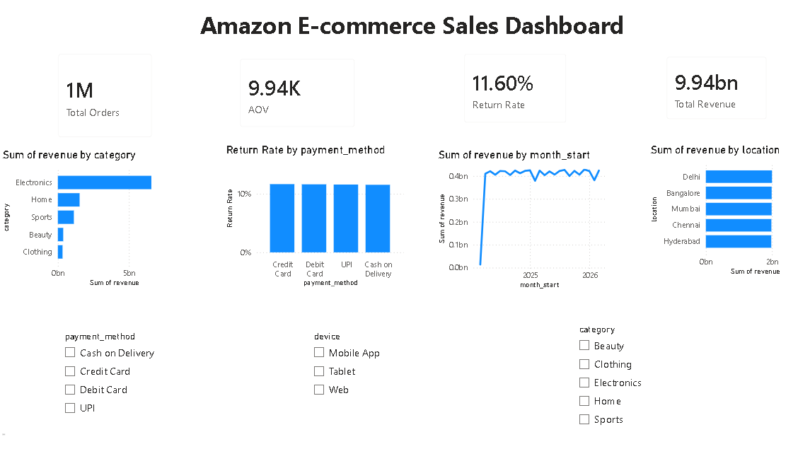

# Amazon Customer and Sales Analysis

## SQL analysis and Power BI dashboard
- Loaded the 1 million orders into SQLite and wrote 9 SQL queries (joins, window functions, CTEs) to answer business questions. The queries and results are in the notebook.
- Built a Power BI dashboard with revenue, orders, average order value and return-rate KPIs, filterable by category, device and payment method (`amazon_dashboard.pbix`).

### Findings from SQL
* Electronics generates 66.2% of revenue (query 2).
* Repeat customers are 45% of customers (274,070 of 603,815) but generate 67.1% of revenue, while one-time customers account for 32.9% (query 7).
* Return rate is almost the same across payment methods, categories and discount bands: 11.0% to 11.9% (queries 4 and 5).
* Average rating is 3.93 at every shipping time from 1 to 6 days, so shipping time and ratings are unrelated (query 9).
* Orders with a discount of 40% or more have a slightly lower average rating (3.85) than other discount bands (3.95 to 3.97) (query 5).

### Limitations
The dataset shows very little variation across locations and payment methods, and the first month (March 2024) is only partial.

---

## Overview

This project analyzes Amazon e-commerce transaction data to uncover insights related to revenue, customer behavior, pricing strategies, shipping performance, and seller effectiveness.

The goal is to demonstrate practical data analysis and visualization skills using Python without applying machine learning models.

---

## Project Preview

## Visualizations

### Revenue by Category

### Top Brands by Revenue

### Shipping Time vs Rating

### Return Rate Analysis

### Payment Method Usage

### Device Usage Distribution

### Revenue by Location

### Seller Performance Analysis

### Customer Rating Distribution

### Correlation Matrix

---

## Objectives

- Identify key revenue drivers
- Analyze customer purchasing behavior
- Evaluate the impact of discounts on pricing
- Examine shipping performance and customer satisfaction
- Compare category, brand, seller, and regional performance
- Understand return and delivery patterns

---

## Dataset

Dataset: Amazon E-Commerce Dataset

The dataset contains transaction-level information including:

- Product and category details
- Pricing and discounts
- Customer ratings and reviews
- Shipping and delivery information
- Seller performance metrics
- Device and payment method data

Downloaded directly using KaggleHub.

---

## Tools Used

- Python
- Pandas
- NumPy
- Matplotlib
- Seaborn
- Plotly
- KaggleHub

---

## Key KPIs

- Total Revenue
- Total Orders
- Unique Customers
- Unique Products
- Average Rating
- Return Rate
- Average Shipping Time
- Average Discount

---

## Analysis Workflow

1. Data Loading and Inspection
2. Data Cleaning and Preprocessing
3. Exploratory Data Analysis (EDA)
4. KPI Calculation
5. Business-Focused Visualizations
6. Insight Generation and Recommendations

---

## Visualizations

- Revenue by Category
- Top 10 Subcategories by Revenue
- Top Brands by Revenue
- Price vs Final Price
- Discount vs Rating
- Shipping Time vs Rating
- Return Rate Analysis
- Payment Method Usage
- Device Usage Distribution
- Revenue by Location
- Seller Performance Analysis
- Rating Distribution
- Shipping Time Distribution
- Category vs Rating
- Correlation Heatmap

---

## Key Insights

- Electronics generates about two-thirds of revenue (66.2%).
- Repeat customers generate 67.1% of revenue.
- Higher discounts lower the final price, with a moderate correlation (-0.29).
- Higher-priced products tend to have higher ratings (correlation 0.33).
- Shipping time shows no relationship with ratings (correlation about 0.00002).
- Return rate is about 11.6% overall and is nearly the same across payment methods, categories and discount bands.
